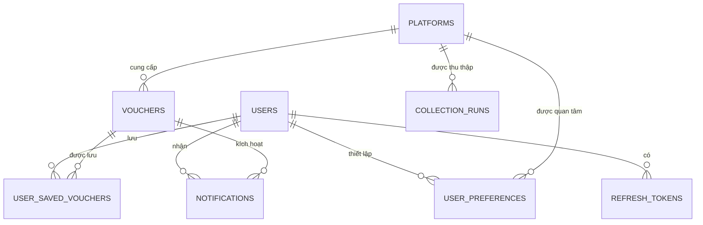

# Data Dictionary & Accesstrade JSON Mapping Specification

| Thuộc tính | Giá trị |
|---|---|
| Dự án | DealHunter — Smart E-commerce Voucher Aggregator |
| Phiên bản | 1.0 |
| Cơ sở dữ liệu | PostgreSQL 15+ / SQLAlchemy 2.x |
| Nguồn dữ liệu | Accesstrade Datafeed / Coupons API |

## Mục lục

- [1. Quy ước dữ liệu](#1-quy-ước-dữ-liệu)
- [2. Sơ đồ quan hệ](#2-sơ-đồ-quan-hệ)
- [3. Từ điển dữ liệu](#3-từ-điển-dữ-liệu)
  - [3.1. users](#31-users)
  - [3.2. refresh_tokens](#32-refresh_tokens)
  - [3.3. platforms](#33-platforms)
  - [3.4. vouchers](#34-vouchers)
  - [3.5. user_saved_vouchers](#35-user_saved_vouchers)
  - [3.6. user_preferences](#36-user_preferences)
  - [3.7. notifications](#37-notifications)
  - [3.8. collection_runs](#38-collection_runs)
- [4. Quy tắc ánh xạ JSON](#4-quy-tắc-ánh-xạ-json)
  - [4.1. Bảng ánh xạ trường](#41-bảng-ánh-xạ-trường)
  - [4.2. Ví dụ chuyển đổi](#42-ví-dụ-chuyển-đổi)

---

## 1. Quy ước dữ liệu

### Khóa chính

Toàn bộ 8 bảng sử dụng `UUID` (UUIDv4). Tầng cơ sở dữ liệu sinh mặc định bằng `gen_random_uuid()` hoặc tầng ứng dụng sinh bằng `uuid.uuid4()`. Cách này bảo đảm tính duy nhất toàn cục, khó đoán và an toàn khi dùng trong URL/API.

### Thời gian

- Kiểu dữ liệu chuẩn: `TIMESTAMPTZ`
- Múi giờ lưu trữ: UTC
- Định dạng ISO 8601: `YYYY-MM-DDTHH:MM:SSZ`

### Tiền tệ và số học

- Kiểu dữ liệu chuẩn: `NUMERIC(12, 2)`
- Không dùng `FLOAT` hoặc `DOUBLE` cho giá trị tài chính để tránh sai số làm tròn.
- Đơn vị chuẩn:
  - VNĐ đối với `FIXED_AMOUNT` và `FREE_SHIPPING`
  - Phần trăm đối với `PERCENTAGE`

### Chuỗi ký tự

- Mã hóa: UTF-8
- Chuẩn Unicode: NFC
- Các trường định danh như `username`, `slug`, `normalized_code` và `dedup_key` phải loại bỏ khoảng trắng thừa trước khi lưu.

### Giá trị rỗng

Trong dữ liệu JSON/CSV:

- `""`, `"null"`, `"N/A"` và chuỗi toàn khoảng trắng ở các trường tùy chọn được chuẩn hóa thành `NULL`.
- Trường bắt buộc (`NOT NULL`) không được thiếu hoặc nhận `NULL`; bản ghi không hợp lệ phải bị từ chối ở bước validation.

---

## 2. Sơ đồ quan hệ



---

## 3. Từ điển dữ liệu

### 3.1. `users`

Lưu thông tin định danh, xác thực và phân quyền của người dùng.

| Cột | Kiểu PostgreSQL | SQLAlchemy | Null | Mặc định | Ràng buộc / chỉ mục | Mô tả |
|---|---|---|---:|---|---|---|
| `id` | `UUID` | `UUID(as_uuid=True)` | Không | `gen_random_uuid()` | `PRIMARY KEY` | Mã định danh người dùng. |
| `username` | `VARCHAR(50)` | `String(50)` | Không | — | `UNIQUE`, `NOT NULL` | Tên đăng nhập; chỉ chứa chữ cái, số và dấu gạch dưới. |
| `email` | `VARCHAR(100)` | `String(100)` | Không | — | `UNIQUE`, `NOT NULL` | Email đăng ký, lưu dạng chữ thường. |
| `password_hash` | `VARCHAR(255)` | `String(255)` | Không | — | `NOT NULL` | Chuỗi băm Bcrypt; không trả về qua API. |
| `role` | `VARCHAR(20)` | `String(20)` | Không | `'USER'` | `CHECK ('USER', 'ADMIN')` | Vai trò RBAC. |
| `created_at` | `TIMESTAMPTZ` | `DateTime(timezone=True)` | Không | `CURRENT_TIMESTAMP` | `NOT NULL` | Thời điểm tạo tài khoản (UTC). |
| `updated_at` | `TIMESTAMPTZ` | `DateTime(timezone=True)` | Không | `CURRENT_TIMESTAMP` | `NOT NULL` | Thời điểm cập nhật gần nhất (UTC). |

### 3.2. `refresh_tokens`

Lưu mã băm Refresh Token để hỗ trợ refresh token rotation và thu hồi phiên đăng nhập.

| Cột | Kiểu PostgreSQL | SQLAlchemy | Null | Mặc định | Ràng buộc / chỉ mục | Mô tả |
|---|---|---|---:|---|---|---|
| `id` | `UUID` | `UUID(as_uuid=True)` | Không | `gen_random_uuid()` | `PRIMARY KEY` | Mã định danh phiên token. |
| `user_id` | `UUID` | `UUID(as_uuid=True)` | Không | — | `FK -> users.id ON DELETE CASCADE` | Người dùng sở hữu token. |
| `token_hash` | `VARCHAR(255)` | `String(255)` | Không | — | `UNIQUE`, `INDEX`, `NOT NULL` | Mã băm SHA-256 của Refresh Token gốc. |
| `expires_at` | `TIMESTAMPTZ` | `DateTime(timezone=True)` | Không | — | `NOT NULL` | Thời điểm hết hạn, mặc định sau 7 ngày. |
| `revoked_at` | `TIMESTAMPTZ` | `DateTime(timezone=True)` | Có | `NULL` | — | Thời điểm thu hồi. `NULL` nghĩa là token còn hiệu lực. |
| `created_at` | `TIMESTAMPTZ` | `DateTime(timezone=True)` | Không | `CURRENT_TIMESTAMP` | `NOT NULL` | Thời điểm cấp phát token (UTC). |

### 3.3. `platforms`

Quản lý danh mục nền tảng thương mại điện tử được thu thập và lọc voucher.

| Cột | Kiểu PostgreSQL | SQLAlchemy | Null | Mặc định | Ràng buộc / chỉ mục | Mô tả |
|---|---|---|---:|---|---|---|
| `id` | `UUID` | `UUID(as_uuid=True)` | Không | `gen_random_uuid()` | `PRIMARY KEY` | Mã định danh nền tảng. |
| `name` | `VARCHAR(100)` | `String(100)` | Không | — | `UNIQUE`, `NOT NULL` | Tên hiển thị, ví dụ: Shopee, Lazada, Tiki. |
| `slug` | `VARCHAR(100)` | `String(100)` | Không | — | `UNIQUE`, `INDEX`, `NOT NULL` | Định danh URL, ví dụ: `shopee`, `lazada`. |
| `base_url` | `VARCHAR(255)` | `String(255)` | Có | `NULL` | — | Đường dẫn trang chủ chính thức. |
| `status` | `VARCHAR(20)` | `String(20)` | Không | `'ACTIVE'` | `CHECK ('ACTIVE', 'INACTIVE')` | Trạng thái hoạt động của nền tảng. |
| `created_at` | `TIMESTAMPTZ` | `DateTime(timezone=True)` | Không | `CURRENT_TIMESTAMP` | `NOT NULL` | Thời điểm khởi tạo bản ghi. |

### 3.4. `vouchers`

Kho dữ liệu mã giảm giá trung tâm sau khi chuẩn hóa từ các nguồn thu thập hoặc Admin nhập thủ công.

| Cột | Kiểu PostgreSQL | SQLAlchemy | Null | Mặc định | Ràng buộc / chỉ mục | Mô tả |
|---|---|---|---:|---|---|---|
| `id` | `UUID` | `UUID(as_uuid=True)` | Không | `gen_random_uuid()` | `PRIMARY KEY` | Mã định danh nội bộ voucher. |
| `platform_id` | `UUID` | `UUID(as_uuid=True)` | Không | — | `FK -> platforms.id`, `NOT NULL` | Nền tảng áp dụng voucher. |
| `dedup_key` | `VARCHAR(128)` | `String(128)` | Không | — | `INDEX`, `NOT NULL` | Khóa chống trùng theo cấp độ `ext`, `code` hoặc `fp`. |
| `source_external_id` | `VARCHAR(255)` | `String(255)` | Có | `NULL` | — | ID voucher ở nguồn bên ngoài. |
| `code` | `VARCHAR(100)` | `String(100)` | Có | `NULL` | — | Mã voucher hiển thị cho người dùng. |
| `normalized_code` | `VARCHAR(100)` | `String(100)` | Có | `NULL` | `INDEX` | Mã viết hoa, loại bỏ khoảng trắng. |
| `title` | `VARCHAR(255)` | `String(255)` | Không | — | `NOT NULL` | Tiêu đề ưu đãi. |
| `description` | `TEXT` | `Text` | Có | `NULL` | — | Điều kiện và mô tả chi tiết. |
| `discount_type` | `VARCHAR(20)` | `String(20)` | Không | — | `CHECK ('FIXED_AMOUNT', 'PERCENTAGE', 'FREE_SHIPPING')` | Loại hình ưu đãi. |
| `discount_value` | `NUMERIC(12, 2)` | `Numeric(12, 2)` | Không | — | `>= 0`, `NOT NULL` | VNĐ hoặc phần trăm theo loại giảm giá. |
| `min_order_value` | `NUMERIC(12, 2)` | `Numeric(12, 2)` | Không | `0.00` | `>= 0`, `NOT NULL` | Giá trị đơn hàng tối thiểu. |
| `max_discount` | `NUMERIC(12, 2)` | `Numeric(12, 2)` | Có | `NULL` | `NULL` hoặc `>= 0` | Mức giảm tối đa bằng VNĐ. |
| `start_date` | `TIMESTAMPTZ` | `DateTime(timezone=True)` | Có | `NULL` | — | Thời điểm bắt đầu hiệu lực (UTC). |
| `expiry_date` | `TIMESTAMPTZ` | `DateTime(timezone=True)` | Có | `NULL` | `INDEX` | Thời điểm hết hạn (UTC). |
| `source_url` | `TEXT` | `Text` | Có | `NULL` | — | URL nhận hoặc áp dụng ưu đãi. |
| `status` | `VARCHAR(20)` | `String(20)` | Không | `'ACTIVE'` | `CHECK ('ACTIVE', 'EXPIRED', 'INACTIVE')`, `INDEX` | Trạng thái vòng đời voucher. |
| `last_verified_at` | `TIMESTAMPTZ` | `DateTime(timezone=True)` | Không | `CURRENT_TIMESTAMP` | `NOT NULL` | Thời điểm Collector xác nhận voucher gần nhất. |
| `created_at` | `TIMESTAMPTZ` | `DateTime(timezone=True)` | Không | `CURRENT_TIMESTAMP` | `INDEX`, `NOT NULL` | Thời điểm ghi nhận lần đầu. |
| `updated_at` | `TIMESTAMPTZ` | `DateTime(timezone=True)` | Không | `CURRENT_TIMESTAMP` | `NOT NULL` | Thời điểm cập nhật gần nhất. |

**Ràng buộc và chỉ mục**

- `UNIQUE (platform_id, dedup_key)` — bảo đảm UPSERT idempotent theo từng nền tảng.
- `INDEX (status, platform_id, expiry_date)` — tối ưu lọc trạng thái, nền tảng và thời hạn.
- `INDEX (created_at DESC, id DESC)` — hỗ trợ phân trang và sắp xếp ổn định.

### 3.5. `user_saved_vouchers`

Bảng liên kết lưu voucher yêu thích giữa người dùng và voucher.

| Cột | Kiểu PostgreSQL | SQLAlchemy | Null | Mặc định | Ràng buộc / chỉ mục | Mô tả |
|---|---|---|---:|---|---|---|
| `id` | `UUID` | `UUID(as_uuid=True)` | Không | `gen_random_uuid()` | `PRIMARY KEY` | Mã định danh bản ghi lưu voucher. |
| `user_id` | `UUID` | `UUID(as_uuid=True)` | Không | — | `FK -> users.id ON DELETE CASCADE`, `NOT NULL` | Người dùng lưu voucher. |
| `voucher_id` | `UUID` | `UUID(as_uuid=True)` | Không | — | `FK -> vouchers.id ON DELETE CASCADE`, `NOT NULL` | Voucher được lưu. |
| `created_at` | `TIMESTAMPTZ` | `DateTime(timezone=True)` | Không | `CURRENT_TIMESTAMP` | `NOT NULL` | Thời điểm lưu voucher. |

> **Ràng buộc:** `UNIQUE (user_id, voucher_id)` — mỗi người dùng chỉ lưu một voucher một lần.

### 3.6. `user_preferences`

Lưu tiêu chí săn voucher cá nhân để hệ thống đối chiếu và gửi thông báo.

| Cột | Kiểu PostgreSQL | SQLAlchemy | Null | Mặc định | Ràng buộc / chỉ mục | Mô tả |
|---|---|---|---:|---|---|---|
| `id` | `UUID` | `UUID(as_uuid=True)` | Không | `gen_random_uuid()` | `PRIMARY KEY` | Mã định danh bộ tiêu chí. |
| `user_id` | `UUID` | `UUID(as_uuid=True)` | Không | — | `FK -> users.id ON DELETE CASCADE`, `NOT NULL` | Người dùng sở hữu tiêu chí. |
| `platform_id` | `UUID` | `UUID(as_uuid=True)` | Có | `NULL` | `FK -> platforms.id ON DELETE SET NULL` | Nền tảng quan tâm; `NULL` áp dụng cho tất cả nền tảng. |
| `min_discount` | `NUMERIC(12, 2)` | `Numeric(12, 2)` | Có | `0.00` | `NULL` hoặc `>= 0` | Mức giảm tối thiểu mong muốn. |
| `min_order_value` | `NUMERIC(12, 2)` | `Numeric(12, 2)` | Có | `NULL` | `NULL` hoặc `>= 0` | Ngưỡng đơn hàng tối đa người dùng chấp nhận. |
| `is_active` | `BOOLEAN` | `Boolean` | Không | `TRUE` | `INDEX`, `NOT NULL` | Bật/tắt bộ tiêu chí. |
| `created_at` | `TIMESTAMPTZ` | `DateTime(timezone=True)` | Không | `CURRENT_TIMESTAMP` | `NOT NULL` | Thời điểm tạo. |
| `updated_at` | `TIMESTAMPTZ` | `DateTime(timezone=True)` | Không | `CURRENT_TIMESTAMP` | `NOT NULL` | Thời điểm cập nhật gần nhất. |

### 3.7. `notifications`

Lưu lịch sử thông báo khi voucher khớp tiêu chí hoặc mức ưu đãi được cải thiện.

| Cột | Kiểu PostgreSQL | SQLAlchemy | Null | Mặc định | Ràng buộc / chỉ mục | Mô tả |
|---|---|---|---:|---|---|---|
| `id` | `UUID` | `UUID(as_uuid=True)` | Không | `gen_random_uuid()` | `PRIMARY KEY` | Mã định danh thông báo. |
| `user_id` | `UUID` | `UUID(as_uuid=True)` | Không | — | `FK -> users.id ON DELETE CASCADE`, `INDEX`, `NOT NULL` | Người dùng nhận thông báo. |
| `voucher_id` | `UUID` | `UUID(as_uuid=True)` | Không | — | `FK -> vouchers.id ON DELETE CASCADE`, `NOT NULL` | Voucher kích hoạt thông báo. |
| `notification_type` | `VARCHAR(30)` | `String(30)` | Không | — | `CHECK ('NEW_MATCH', 'DEAL_IMPROVED')`, `NOT NULL` | Loại sự kiện thông báo. |
| `title` | `VARCHAR(255)` | `String(255)` | Không | — | `NOT NULL` | Tiêu đề hiển thị. |
| `message` | `TEXT` | `Text` | Không | — | `NOT NULL` | Nội dung chi tiết mức ưu đãi. |
| `is_read` | `BOOLEAN` | `Boolean` | Không | `FALSE` | `INDEX`, `NOT NULL` | Trạng thái đã đọc/chưa đọc. |
| `created_at` | `TIMESTAMPTZ` | `DateTime(timezone=True)` | Không | `CURRENT_TIMESTAMP` | `INDEX`, `NOT NULL` | Thời điểm tạo thông báo. |

> **Ràng buộc:** `UNIQUE (user_id, voucher_id, notification_type)` — chống gửi trùng thông báo cho cùng một loại sự kiện.

### 3.8. `collection_runs`

Ghi nhận lịch sử thực thi tác vụ thu thập dữ liệu qua Celery Beat hoặc Admin.

| Cột | Kiểu PostgreSQL | SQLAlchemy | Null | Mặc định | Ràng buộc / chỉ mục | Mô tả |
|---|---|---|---:|---|---|---|
| `id` | `UUID` | `UUID(as_uuid=True)` | Không | `gen_random_uuid()` | `PRIMARY KEY` | Mã định danh phiên thu thập. |
| `platform_id` | `UUID` | `UUID(as_uuid=True)` | Có | `NULL` | `FK -> platforms.id ON DELETE SET NULL` | Nền tảng thu thập; `NULL` nghĩa là thu thập toàn bộ nền tảng đang active. |
| `triggered_by` | `VARCHAR(20)` | `String(20)` | Không | `'SCHEDULER'` | `CHECK ('SCHEDULER', 'ADMIN')`, `NOT NULL` | Nguồn kích hoạt tác vụ. |
| `status` | `VARCHAR(20)` | `String(20)` | Không | `'PENDING'` | `CHECK ('PENDING', 'RUNNING', 'SUCCESS', 'FAILED')`, `NOT NULL` | Trạng thái xử lý. |
| `started_at` | `TIMESTAMPTZ` | `DateTime(timezone=True)` | Không | `CURRENT_TIMESTAMP` | `NOT NULL` | Thời điểm bắt đầu. |
| `finished_at` | `TIMESTAMPTZ` | `DateTime(timezone=True)` | Có | `NULL` | — | Thời điểm hoàn tất hoặc dừng do lỗi. |
| `collected_count` | `INTEGER` | `Integer` | Không | `0` | `>= 0`, `NOT NULL` | Số bản ghi voucher hợp lệ đã insert/update. |
| `error_message` | `TEXT` | `Text` | Có | `NULL` | — | Chi tiết lỗi khi `status = 'FAILED'`. |

---

## 4. Quy tắc ánh xạ JSON

`AccesstradeCollector` hoặc `FileCollector` nhận payload JSON từ Datafeed/Coupons API, sau đó `VoucherNormalizer` chuẩn hóa dữ liệu trước khi chạy thuật toán chống trùng.

### 4.1. Bảng ánh xạ trường

| Trường nguồn | Kiểu nguồn | Cột đích | Kiểu đích | Quy tắc chuẩn hóa | Ngoại lệ / mặc định |
|---|---|---|---|---|---|
| `merchant`, `campaign_slug`, `domain` | `string` | `vouchers.platform_id` qua `platforms.slug` | `UUID` | Chuyển chữ thường và ánh xạ tên sàn: `shopee_vn`, `shopee.vn`, `Shopee` → `slug = shopee`. Sau đó truy vấn `platforms.id`. | Không khớp hoặc nền tảng không active: bỏ bản ghi và ghi warning. |
| `id`, `coupon_id` | `string` / `int` | `vouchers.source_external_id` | `VARCHAR(255)` | `str(value).strip()`; giữ nguyên phân biệt hoa/thường của ID nguồn. | `NULL`, chuỗi rỗng hoặc thiếu trường → `NULL`; dùng cấp 2/cấp 3 để tính `dedup_key`. |
| `coupon_code`, `code` | `string` | `vouchers.code`, `vouchers.normalized_code` | `VARCHAR(100)` | `code = val.strip()`; `normalized_code = re.sub(r'\s+', '', val.strip()).upper()`. | `NULL`, rỗng hoặc giá trị giả `NO_CODE`, `NONE` → cả hai trường đều `NULL`. |
| `name`, `title` | `string` | `vouchers.title` | `VARCHAR(255)` | Loại bỏ HTML, chuẩn hóa khoảng trắng thành một dấu cách, Unicode NFC và giới hạn 255 ký tự. | Thiếu/rỗng → reject và tăng biến đếm lỗi. |
| `content`, `desc`, `description` | `string` | `vouchers.description` | `TEXT` | Làm sạch thẻ HTML và giữ nội dung điều kiện chi tiết. | Thiếu/rỗng → `NULL`. |
| `discount_type`, `discount_value`, `discount_percentage` | `string` / `number` | `vouchers.discount_type`, `vouchers.discount_value` | `VARCHAR(20)`, `NUMERIC(12,2)` | Nếu `discount_percentage > 0` hoặc `type = percentage` → `PERCENTAGE`; nếu freeship → `FREE_SHIPPING`; trường hợp còn lại → `FIXED_AMOUNT`. | Loại bỏ `đ`, `VND`, dấu `,` rồi ép sang `Decimal`; giá trị âm hoặc phần trăm > 100 → reject. |
| `min_spend`, `min_order_value` | `number` / `string` | `vouchers.min_order_value` | `NUMERIC(12,2)` | Loại bỏ ký tự phân cách hàng nghìn, ép sang `Decimal`, làm tròn 2 chữ số. | Thiếu/rỗng → `0.00`; giá trị âm → reject. |
| `max_discount`, `max_value` | `number` / `string` | `vouchers.max_discount` | `NUMERIC(12,2)` | Ép sang `Decimal`, làm tròn 2 chữ số. | `NULL`, rỗng, thiếu hoặc `<= 0` → `NULL`. |
| `start_time`, `start_date` | `string` / Unix timestamp | `vouchers.start_date` | `TIMESTAMPTZ` | Parse ISO 8601, `YYYY-MM-DD HH:MM:SS` hoặc Unix epoch; mặc định múi giờ nguồn `+07:00` khi thiếu offset, sau đó chuyển UTC. | Thiếu/rỗng hoặc sai định dạng → `NULL` và ghi cảnh báo. |
| `end_time`, `expired_date`, `end_date` | `string` / Unix timestamp | `vouchers.expiry_date` | `TIMESTAMPTZ` | Parse tương tự `start_date`; nếu chỉ có `YYYY-MM-DD`, gán `23:59:59+07:00` rồi chuyển UTC. | Thiếu/rỗng → `NULL`; đã hết hạn → đánh dấu `EXPIRED` hoặc không nạp mới. |
| `aff_link`, `link`, `url` | `string` | `vouchers.source_url` | `TEXT` | `val.strip()`; chỉ nhận URL có scheme `http://` hoặc `https://`. | Thiếu/rỗng hoặc không hợp lệ → `NULL`. |
| *Tính toán hệ thống* | — | `vouchers.dedup_key` | `VARCHAR(128)` | Sinh theo ba cấp độ: `ext:`, `code:` hoặc `fp:` sau khi đã chuẩn hóa các trường nguồn. | Bắt buộc khác `NULL`. |
| *Tính toán hệ thống* | — | `vouchers.status` | `VARCHAR(20)` | Nếu `expiry_date <= NOW(UTC)` → `EXPIRED`; ngược lại → `ACTIVE`. | Mặc định `ACTIVE`. |

### 4.2. Ví dụ chuyển đổi

#### Payload đầu vào

```json
{
  "id": "AT_9981273",
  "merchant": "shopee",
  "coupon_code": "  sale50k_nov ",
  "name": "Giảm 50.000đ cho đơn hàng thời trang từ 200K",
  "content": "<p>Áp dụng cho toàn bộ sản phẩm thuộc ngành hàng Thời trang Nam/Nữ.</p>",
  "discount_type": "fixed",
  "discount_value": 50000,
  "min_spend": 200000,
  "max_discount": null,
  "start_time": "2026-11-20 00:00:00",
  "end_time": "2026-11-30 23:59:59",
  "aff_link": "https://go.isclix.com/deep_link/abc123?url=https%3A%2F%2Fshopee.vn"
}
```

#### Bản ghi sau chuẩn hóa

```json
{
  "platform_id": "550e8400-e29b-41d4-a716-446655440001",
  "dedup_key": "ext:AT_9981273",
  "source_external_id": "AT_9981273",
  "code": "sale50k_nov",
  "normalized_code": "SALE50KNOV",
  "title": "Giảm 50.000đ cho đơn hàng thời trang từ 200K",
  "description": "Áp dụng cho toàn bộ sản phẩm thuộc ngành hàng Thời trang Nam/Nữ.",
  "discount_type": "FIXED_AMOUNT",
  "discount_value": "50000.00",
  "min_order_value": "200000.00",
  "max_discount": null,
  "start_date": "2026-11-19T17:00:00Z",
  "expiry_date": "2026-11-30T16:59:59Z",
  "source_url": "https://go.isclix.com/deep_link/abc123?url=https%3A%2F%2Fshopee.vn",
  "status": "ACTIVE"
}
```
