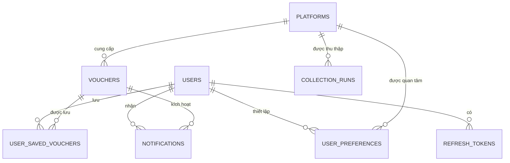

# Data Dictionary & Accesstrade Offers Information API Mapping Specification

| Thuộc tính | Giá trị |
|---|---|
| Dự án | DealHunter — Smart E-commerce Voucher Aggregator |
| Phiên bản | 1.0 |
| Cơ sở dữ liệu | PostgreSQL 15+ / SQLAlchemy 2.x |
| Nguồn dữ liệu | Accesstrade Offers Information API |

## Mục lục

- [1. Quy ước dữ liệu](#1-quy-ước-dữ-liệu)
- [2. Sơ đồ quan hệ](#2-sơ-đồ-quan-hệ)
- [3. Từ điển dữ liệu](#3-từ-điển-dữ-liệu)
  - [3.1. users](#31-users)
  - [3.2. refresh_tokens](#32-refresh_tokens)
  - [3.3. platforms](#33-platforms)
  - [3.4. vouchers](#34-vouchers)
  - [3.5. user_saved_vouchers](#35-user_saved_vouchers)
  - [3.6. user_preferences](#36-user_preferences)
  - [3.7. notifications](#37-notifications)
  - [3.8. collection_runs](#38-collection_runs)
- [4. Quy tắc Ánh xạ dữ liệu từ Accesstrade Offers Information API](#4-quy-tắc-ánh-xạ-dữ-liệu-từ-accesstrade-offers-information-api)
  - [4.1. Tiền xử lý payload và làm phẳng](#41-tiền-xử-lý-payload-và-làm-phẳng-flatten)
  - [4.2. Bảng quy tắc ánh xạ trường](#42-bảng-quy-tắc-ánh-xạ-trường)
  - [4.3. Quy tắc Regex bóc tách giá trị ưu đãi](#43-quy-tắc-regex-bóc-tách-giá-trị-ưu-đãi-từ-văn-bản-tiếng-việt)
  - [4.4. Ví dụ ánh xạ thực tế](#44-ví-dụ-ánh-xạ-thực-tế)

---

## 1. Quy ước dữ liệu

### Khóa chính

Toàn bộ 8 bảng sử dụng `UUID` (UUIDv4). Tầng cơ sở dữ liệu sinh mặc định bằng `gen_random_uuid()` hoặc tầng ứng dụng sinh bằng `uuid.uuid4()`. Cách này bảo đảm tính duy nhất toàn cục, khó đoán và an toàn khi dùng trong URL/API.

### Thời gian

- Kiểu dữ liệu chuẩn: `TIMESTAMPTZ`
- Múi giờ lưu trữ: UTC
- Định dạng ISO 8601: `YYYY-MM-DDTHH:MM:SSZ`

### Tiền tệ và số học

- Kiểu dữ liệu chuẩn: `NUMERIC(12, 2)`
- Không dùng `FLOAT` hoặc `DOUBLE` cho giá trị tài chính để tránh sai số làm tròn.
- Đơn vị chuẩn:
  - VNĐ đối với `FIXED_AMOUNT` và `FREE_SHIPPING`
  - Phần trăm đối với `PERCENTAGE`

### Chuỗi ký tự

- Mã hóa: UTF-8
- Chuẩn Unicode: NFC
- Các trường định danh như `username`, `slug`, `normalized_code` và `dedup_key` phải loại bỏ khoảng trắng thừa trước khi lưu.

### Giá trị rỗng

Trong dữ liệu JSON/CSV:

- `""`, `"null"`, `"N/A"` và chuỗi toàn khoảng trắng ở các trường tùy chọn được chuẩn hóa thành `NULL`.
- Trường bắt buộc (`NOT NULL`) không được thiếu hoặc nhận `NULL`; bản ghi không hợp lệ phải bị từ chối ở bước validation.

---

## 2. Sơ đồ quan hệ



---

## 3. Từ điển dữ liệu

### 3.1. `users`

Lưu thông tin định danh, xác thực và phân quyền của người dùng.

| Cột | Kiểu PostgreSQL | SQLAlchemy | Null | Mặc định | Ràng buộc / chỉ mục | Mô tả |
|---|---|---|---:|---|---|---|
| `id` | `UUID` | `UUID(as_uuid=True)` | Không | `gen_random_uuid()` | `PRIMARY KEY` | Mã định danh người dùng. |
| `username` | `VARCHAR(50)` | `String(50)` | Không | — | `UNIQUE`, `NOT NULL` | Tên đăng nhập; chỉ chứa chữ cái, số và dấu gạch dưới. |
| `email` | `VARCHAR(100)` | `String(100)` | Không | — | `UNIQUE`, `NOT NULL` | Email đăng ký, lưu dạng chữ thường. |
| `password_hash` | `VARCHAR(255)` | `String(255)` | Không | — | `NOT NULL` | Chuỗi băm Bcrypt; không trả về qua API. |
| `role` | `VARCHAR(20)` | `String(20)` | Không | `'USER'` | `CHECK ('USER', 'ADMIN')` | Vai trò RBAC. |
| `created_at` | `TIMESTAMPTZ` | `DateTime(timezone=True)` | Không | `CURRENT_TIMESTAMP` | `NOT NULL` | Thời điểm tạo tài khoản (UTC). |
| `updated_at` | `TIMESTAMPTZ` | `DateTime(timezone=True)` | Không | `CURRENT_TIMESTAMP` | `NOT NULL` | Thời điểm cập nhật gần nhất (UTC). |

### 3.2. `refresh_tokens`

Lưu mã băm Refresh Token để hỗ trợ refresh token rotation và thu hồi phiên đăng nhập.

| Cột | Kiểu PostgreSQL | SQLAlchemy | Null | Mặc định | Ràng buộc / chỉ mục | Mô tả |
|---|---|---|---:|---|---|---|
| `id` | `UUID` | `UUID(as_uuid=True)` | Không | `gen_random_uuid()` | `PRIMARY KEY` | Mã định danh phiên token. |
| `user_id` | `UUID` | `UUID(as_uuid=True)` | Không | — | `FK -> users.id ON DELETE CASCADE` | Người dùng sở hữu token. |
| `token_hash` | `VARCHAR(255)` | `String(255)` | Không | — | `UNIQUE`, `INDEX`, `NOT NULL` | Mã băm SHA-256 của Refresh Token gốc. |
| `expires_at` | `TIMESTAMPTZ` | `DateTime(timezone=True)` | Không | — | `NOT NULL` | Thời điểm hết hạn, mặc định sau 7 ngày. |
| `revoked_at` | `TIMESTAMPTZ` | `DateTime(timezone=True)` | Có | `NULL` | — | Thời điểm thu hồi. `NULL` nghĩa là token còn hiệu lực. |
| `created_at` | `TIMESTAMPTZ` | `DateTime(timezone=True)` | Không | `CURRENT_TIMESTAMP` | `NOT NULL` | Thời điểm cấp phát token (UTC). |

### 3.3. `platforms`

Quản lý danh mục nền tảng thương mại điện tử được thu thập và lọc voucher.

| Cột | Kiểu PostgreSQL | SQLAlchemy | Null | Mặc định | Ràng buộc / chỉ mục | Mô tả |
|---|---|---|---:|---|---|---|
| `id` | `UUID` | `UUID(as_uuid=True)` | Không | `gen_random_uuid()` | `PRIMARY KEY` | Mã định danh nền tảng. |
| `name` | `VARCHAR(100)` | `String(100)` | Không | — | `UNIQUE`, `NOT NULL` | Tên hiển thị, ví dụ: Shopee, Lazada, Tiki. |
| `slug` | `VARCHAR(100)` | `String(100)` | Không | — | `UNIQUE`, `INDEX`, `NOT NULL` | Định danh URL, ví dụ: `shopee`, `lazada`. |
| `base_url` | `VARCHAR(255)` | `String(255)` | Có | `NULL` | — | Đường dẫn trang chủ chính thức. |
| `status` | `VARCHAR(20)` | `String(20)` | Không | `'ACTIVE'` | `CHECK ('ACTIVE', 'INACTIVE')` | Trạng thái hoạt động của nền tảng. |
| `created_at` | `TIMESTAMPTZ` | `DateTime(timezone=True)` | Không | `CURRENT_TIMESTAMP` | `NOT NULL` | Thời điểm khởi tạo bản ghi. |

### 3.4. `vouchers`

Kho dữ liệu mã giảm giá trung tâm. Tài liệu này mô tả dữ liệu voucher được thu thập tự động và chuẩn hóa từ **Accesstrade Offers Information API** theo chu kỳ định kỳ.

| Cột | Kiểu PostgreSQL | SQLAlchemy | Null | Mặc định | Ràng buộc / chỉ mục | Mô tả |
|---|---|---|---:|---|---|---|
| `id` | `UUID` | `UUID(as_uuid=True)` | Không | `gen_random_uuid()` | `PRIMARY KEY` | Mã định danh nội bộ voucher. |
| `platform_id` | `UUID` | `UUID(as_uuid=True)` | Không | — | `FK -> platforms.id`, `NOT NULL` | Nền tảng áp dụng voucher. |
| `dedup_key` | `VARCHAR(128)` | `String(128)` | Không | — | `INDEX`, `NOT NULL` | Khóa chống trùng theo cấp độ `ext`, `code` hoặc `fp`. |
| `source_external_id` | `VARCHAR(255)` | `String(255)` | Có | `NULL` | — | ID voucher ở nguồn bên ngoài. |
| `code` | `VARCHAR(100)` | `String(100)` | Có | `NULL` | — | Mã voucher hiển thị cho người dùng. |
| `normalized_code` | `VARCHAR(100)` | `String(100)` | Có | `NULL` | `INDEX` | Mã viết hoa, loại bỏ khoảng trắng. |
| `title` | `VARCHAR(255)` | `String(255)` | Không | — | `NOT NULL` | Tiêu đề ưu đãi. |
| `description` | `TEXT` | `Text` | Có | `NULL` | — | Điều kiện và mô tả chi tiết. |
| `discount_type` | `VARCHAR(20)` | `String(20)` | Không | — | `CHECK ('FIXED_AMOUNT', 'PERCENTAGE', 'FREE_SHIPPING')` | Loại hình ưu đãi. |
| `discount_value` | `NUMERIC(12, 2)` | `Numeric(12, 2)` | Không | — | `>= 0`, `NOT NULL` | VNĐ hoặc phần trăm theo loại giảm giá. |
| `min_order_value` | `NUMERIC(12, 2)` | `Numeric(12, 2)` | Không | `0.00` | `>= 0`, `NOT NULL` | Giá trị đơn hàng tối thiểu. |
| `max_discount` | `NUMERIC(12, 2)` | `Numeric(12, 2)` | Có | `NULL` | `NULL` hoặc `>= 0` | Mức giảm tối đa bằng VNĐ. |
| `start_date` | `TIMESTAMPTZ` | `DateTime(timezone=True)` | Có | `NULL` | — | Thời điểm bắt đầu hiệu lực (UTC). |
| `expiry_date` | `TIMESTAMPTZ` | `DateTime(timezone=True)` | Có | `NULL` | `INDEX` | Thời điểm hết hạn (UTC). |
| `source_url` | `TEXT` | `Text` | Có | `NULL` | — | URL nhận hoặc áp dụng ưu đãi. |
| `status` | `VARCHAR(20)` | `String(20)` | Không | `'ACTIVE'` | `CHECK ('ACTIVE', 'EXPIRED', 'INACTIVE')`, `INDEX` | Trạng thái vòng đời voucher. |
| `last_verified_at` | `TIMESTAMPTZ` | `DateTime(timezone=True)` | Không | `CURRENT_TIMESTAMP` | `NOT NULL` | Thời điểm Collector xác nhận voucher gần nhất. |
| `created_at` | `TIMESTAMPTZ` | `DateTime(timezone=True)` | Không | `CURRENT_TIMESTAMP` | `INDEX`, `NOT NULL` | Thời điểm ghi nhận lần đầu. |
| `updated_at` | `TIMESTAMPTZ` | `DateTime(timezone=True)` | Không | `CURRENT_TIMESTAMP` | `NOT NULL` | Thời điểm cập nhật gần nhất. |

**Ràng buộc và chỉ mục**

- `UNIQUE (platform_id, dedup_key)` — bảo đảm UPSERT idempotent theo từng nền tảng.
- `INDEX (status, platform_id, expiry_date)` — tối ưu lọc trạng thái, nền tảng và thời hạn.
- `INDEX (created_at DESC, id DESC)` — hỗ trợ phân trang và sắp xếp ổn định.

### 3.5. `user_saved_vouchers`

Bảng liên kết lưu voucher yêu thích giữa người dùng và voucher.

| Cột | Kiểu PostgreSQL | SQLAlchemy | Null | Mặc định | Ràng buộc / chỉ mục | Mô tả |
|---|---|---|---:|---|---|---|
| `id` | `UUID` | `UUID(as_uuid=True)` | Không | `gen_random_uuid()` | `PRIMARY KEY` | Mã định danh bản ghi lưu voucher. |
| `user_id` | `UUID` | `UUID(as_uuid=True)` | Không | — | `FK -> users.id ON DELETE CASCADE`, `NOT NULL` | Người dùng lưu voucher. |
| `voucher_id` | `UUID` | `UUID(as_uuid=True)` | Không | — | `FK -> vouchers.id ON DELETE CASCADE`, `NOT NULL` | Voucher được lưu. |
| `created_at` | `TIMESTAMPTZ` | `DateTime(timezone=True)` | Không | `CURRENT_TIMESTAMP` | `NOT NULL` | Thời điểm lưu voucher. |

> **Ràng buộc:** `UNIQUE (user_id, voucher_id)` — mỗi người dùng chỉ lưu một voucher một lần.

### 3.6. `user_preferences`

Lưu tiêu chí săn voucher cá nhân để hệ thống đối chiếu và gửi thông báo.

| Cột | Kiểu PostgreSQL | SQLAlchemy | Null | Mặc định | Ràng buộc / chỉ mục | Mô tả |
|---|---|---|---:|---|---|---|
| `id` | `UUID` | `UUID(as_uuid=True)` | Không | `gen_random_uuid()` | `PRIMARY KEY` | Mã định danh bộ tiêu chí. |
| `user_id` | `UUID` | `UUID(as_uuid=True)` | Không | — | `FK -> users.id ON DELETE CASCADE`, `NOT NULL` | Người dùng sở hữu tiêu chí. |
| `platform_id` | `UUID` | `UUID(as_uuid=True)` | Có | `NULL` | `FK -> platforms.id ON DELETE SET NULL` | Nền tảng quan tâm; `NULL` áp dụng cho tất cả nền tảng. |
| `min_discount` | `NUMERIC(12, 2)` | `Numeric(12, 2)` | Có | `0.00` | `NULL` hoặc `>= 0` | Mức giảm tối thiểu mong muốn. |
| `min_order_value` | `NUMERIC(12, 2)` | `Numeric(12, 2)` | Có | `NULL` | `NULL` hoặc `>= 0` | Ngưỡng đơn hàng tối đa người dùng chấp nhận. |
| `is_active` | `BOOLEAN` | `Boolean` | Không | `TRUE` | `INDEX`, `NOT NULL` | Bật/tắt bộ tiêu chí. |
| `created_at` | `TIMESTAMPTZ` | `DateTime(timezone=True)` | Không | `CURRENT_TIMESTAMP` | `NOT NULL` | Thời điểm tạo. |
| `updated_at` | `TIMESTAMPTZ` | `DateTime(timezone=True)` | Không | `CURRENT_TIMESTAMP` | `NOT NULL` | Thời điểm cập nhật gần nhất. |

### 3.7. `notifications`

Lưu lịch sử thông báo khi voucher khớp tiêu chí hoặc mức ưu đãi được cải thiện.

| Cột | Kiểu PostgreSQL | SQLAlchemy | Null | Mặc định | Ràng buộc / chỉ mục | Mô tả |
|---|---|---|---:|---|---|---|
| `id` | `UUID` | `UUID(as_uuid=True)` | Không | `gen_random_uuid()` | `PRIMARY KEY` | Mã định danh thông báo. |
| `user_id` | `UUID` | `UUID(as_uuid=True)` | Không | — | `FK -> users.id ON DELETE CASCADE`, `INDEX`, `NOT NULL` | Người dùng nhận thông báo. |
| `voucher_id` | `UUID` | `UUID(as_uuid=True)` | Không | — | `FK -> vouchers.id ON DELETE CASCADE`, `NOT NULL` | Voucher kích hoạt thông báo. |
| `notification_type` | `VARCHAR(30)` | `String(30)` | Không | — | `CHECK ('NEW_MATCH', 'DEAL_IMPROVED')`, `NOT NULL` | Loại sự kiện thông báo. |
| `title` | `VARCHAR(255)` | `String(255)` | Không | — | `NOT NULL` | Tiêu đề hiển thị. |
| `message` | `TEXT` | `Text` | Không | — | `NOT NULL` | Nội dung chi tiết mức ưu đãi. |
| `is_read` | `BOOLEAN` | `Boolean` | Không | `FALSE` | `INDEX`, `NOT NULL` | Trạng thái đã đọc/chưa đọc. |
| `created_at` | `TIMESTAMPTZ` | `DateTime(timezone=True)` | Không | `CURRENT_TIMESTAMP` | `INDEX`, `NOT NULL` | Thời điểm tạo thông báo. |

> **Ràng buộc:** `UNIQUE (user_id, voucher_id, notification_type)` — chống gửi trùng thông báo cho cùng một loại sự kiện.

### 3.8. `collection_runs`

Ghi nhận lịch sử thực thi tác vụ thu thập dữ liệu qua Celery Beat hoặc Admin.

| Cột | Kiểu PostgreSQL | SQLAlchemy | Null | Mặc định | Ràng buộc / chỉ mục | Mô tả |
|---|---|---|---:|---|---|---|
| `id` | `UUID` | `UUID(as_uuid=True)` | Không | `gen_random_uuid()` | `PRIMARY KEY` | Mã định danh phiên thu thập. |
| `platform_id` | `UUID` | `UUID(as_uuid=True)` | Có | `NULL` | `FK -> platforms.id ON DELETE SET NULL` | Nền tảng thu thập; `NULL` nghĩa là thu thập toàn bộ nền tảng đang active. |
| `triggered_by` | `VARCHAR(20)` | `String(20)` | Không | `'SCHEDULER'` | `CHECK ('SCHEDULER', 'ADMIN')`, `NOT NULL` | Nguồn kích hoạt tác vụ. |
| `status` | `VARCHAR(20)` | `String(20)` | Không | `'PENDING'` | `CHECK ('PENDING', 'RUNNING', 'SUCCESS', 'FAILED')`, `NOT NULL` | Trạng thái xử lý. |
| `started_at` | `TIMESTAMPTZ` | `DateTime(timezone=True)` | Không | `CURRENT_TIMESTAMP` | `NOT NULL` | Thời điểm bắt đầu. |
| `finished_at` | `TIMESTAMPTZ` | `DateTime(timezone=True)` | Có | `NULL` | — | Thời điểm hoàn tất hoặc dừng do lỗi. |
| `collected_count` | `INTEGER` | `Integer` | Không | `0` | `>= 0`, `NOT NULL` | Số bản ghi voucher hợp lệ đã insert/update. |
| `error_message` | `TEXT` | `Text` | Có | `NULL` | — | Chi tiết lỗi khi `status = 'FAILED'`. |

---

## 4. Quy tắc Ánh xạ Dữ liệu từ Accesstrade Offers Information API

Hệ thống đồng bộ dữ liệu tự động qua `AccesstradeAPICollector` bằng endpoint:

```http
GET https://api.accesstrade.vn/v1/offers_informations
```

Các tham số phân trang gồm `page` và `limit`. Mọi request phải gửi header:

```http
Authorization: Token <ACCESS_KEY>
```

Sau khi nhận phản hồi, `VoucherNormalizer` chuẩn hóa dữ liệu trước khi chạy thuật toán chống trùng.

### 4.1. Tiền xử lý Payload và Làm phẳng (Flatten)

1. **Đọc danh sách offer**
   - Lấy mảng `response["data"]`.
   - Tiếp tục đọc tới khi `data` rỗng hoặc đạt giới hạn trang đã cấu hình.

2. **Tách mảng `coupons[]`**
   - Nếu `coupons` rỗng (`[]`): tạo một bản ghi deal giảm giá trực tiếp.
     - `code = NULL`
     - Dùng `dedup_key` cấp 1 `ext:<id>`
   - Nếu `coupons` có $N$ phần tử (`N >= 1`): tách thành $N$ bản ghi voucher độc lập.
     - Kế thừa `id`, `merchant`, `domain`, `name`, `content`, `start_time`, `end_time`, `aff_link` và `link` của offer.
     - Gán `coupon_code` tương ứng cho từng bản ghi.

### 4.2. Bảng quy tắc ánh xạ trường

| Trường nguồn (Accesstrade API) | Kiểu nguồn | Cột đích (`vouchers`) | Quy tắc biến đổi và chuẩn hóa | Ngoại lệ / mặc định |
|---|---|---|---|---|
| `merchant`, `domain` | `string` | `platform_id` qua `platforms.slug` | Chuẩn hóa về chữ thường và ánh xạ qua từ điển sàn: `tikivn` hoặc `tiki.vn` → `tiki`; `shopeevn` hoặc `shopee.vn` → `shopee`; `lazadavn` hoặc `lazada.vn` → `lazada`. Sau đó lấy `platforms.id`. | Không khớp sàn trong `platforms` hoặc sàn đang `INACTIVE` → bỏ bản ghi. |
| `id` kết hợp `coupon_code` | `string` | `source_external_id` | Offer có tối đa một mã: `str(id).strip()`; ví dụ `tiki-79650804`. Offer tách nhiều mã: ghép `f"{id}_{normalized_code}"` để phân biệt từng mã trong cùng offer. | `id` rỗng hoặc thiếu → `NULL`; chuyển sang cấp 2 hoặc cấp 3 khi tính `dedup_key`. |
| `coupons[].coupon_code` | `string` | `code`, `normalized_code` | `code = val.strip()` giữ nguyên định dạng hiển thị. `normalized_code = re.sub(r'\s+', '', val.strip()).upper()`; ví dụ `399K35K`. | `coupons` rỗng hoặc `coupon_code` rỗng → cả hai trường đều `NULL`. |
| `name` | `string` | `title` | Làm sạch thẻ HTML, chuẩn hóa Unicode NFC, gộp khoảng trắng thừa và cắt tối đa 255 ký tự. | Thiếu hoặc rỗng → loại bỏ bản ghi. |
| `coupons[].coupon_desc`, `content` | `string` | `description` | Ghép `coupon_desc` nếu có với `content`, chuẩn hóa xuống dòng `\n` và loại bỏ thẻ HTML. | Cả hai đều rỗng → `NULL`. |
| *Trích xuất bằng Regex* | `string` | `discount_type`, `discount_value`, `min_order_value`, `max_discount` | Áp dụng bộ quy tắc bóc tách ưu đãi trong [Mục 4.3](#43-quy-tắc-regex-bóc-tách-giá-trị-ưu-đãi-từ-văn-bản-tiếng-việt). | Không trích xuất được giá trị giảm hợp lệ → `FIXED_AMOUNT`, `discount_value = 0.00`; ưu tiên `FREE_SHIPPING` nếu có từ khóa freeship. |
| `start_time` | `string` | `start_date` | Nếu là `YYYY-MM-DD`, gán `00:00:00+07:00`, sau đó quy đổi về UTC (`TIMESTAMPTZ`). | `NULL` hoặc sai định dạng → `NULL`. |
| `end_time` | `string` | `expiry_date` | Nếu là `YYYY-MM-DD`, gán `23:59:59+07:00`, sau đó quy đổi về UTC. | `NULL` → `NULL`; nhỏ hơn hoặc bằng `NOW(UTC)` → `EXPIRED`. |
| `aff_link`, `link` | `string` | `source_url` | Ưu tiên `aff_link`, dự phòng `link` nếu `aff_link` rỗng; kiểm tra scheme `http://` hoặc `https://`. | Không hợp lệ hoặc rỗng → `NULL`. |
| *Tính toán nội bộ* | — | `dedup_key` | Sinh theo thuật toán chống trùng 3 cấp độ: `ext:`, `code:` hoặc `fp:`. | Bắt buộc `NOT NULL`. |
| *Tính toán nội bộ* | — | `status` | Nếu `expiry_date <= NOW(UTC)` thì `EXPIRED`; ngược lại `ACTIVE`. | Mặc định `ACTIVE`. |

### 4.3. Quy tắc Regex bóc tách giá trị ưu đãi từ văn bản tiếng Việt

Thứ tự ưu tiên nguồn văn bản:

1. `coupon_desc`
2. `name`
3. `content`

#### 4.3.1. Quy đổi đơn vị tiền tệ

Hàm `parse_vnd_amount` xử lý các dạng sau:

- Hậu tố `k` hoặc `K`: nhân với `1,000`.
  - `35K` → `35000.00`
  - `399k` → `399000.00`
  - `1.5K` → `1500.00`
- Hậu tố `tr` hoặc `triệu`: nhân với `1,000,000`.
  - `1tr` → `1000000.00`
  - `1.5 triệu` → `1500000.00`
- Dấu chấm/phẩy phân cách nghìn hoặc hậu tố `đ`/`vnđ`: loại bỏ dấu phân cách.
  - `35.000đ` → `35000.00`
  - `100,000 VND` → `100000.00`

#### 4.3.2. Xác định loại và giá trị giảm

| Ưu tiên | Loại | Regex / điều kiện | Kết quả |
|---:|---|---|---|
| 1 | `PERCENTAGE` | `giảm\s*(\d+(?:[.,]\d+)?)\s*%` | `discount_value = Decimal(số phần trăm)` |
| 2 | `FIXED_AMOUNT` | `(?:giảm|hoàn)\s*(\d+(?:[.,]\d+)?\s*(?:k|tr|triệu|đ|vnđ)?)` | `discount_value = parse_vnd_amount(...)` |
| 3 | `FREE_SHIPPING` | `freeship\|miễn phí vận chuyển\|free ship` | `discount_value =` số tiền giảm phí ship nếu có, ngược lại `0.00` |

#### 4.3.3. Xác định ngưỡng đơn tối thiểu

Khớp mẫu:

```regex
(?:đơn(?:\s*hàng)?\s*từ|từ|cho\s*đơn)\s*(\d+(?:[.,]\d+)?\s*(?:k|tr|triệu|đ|vnđ)?)
```

Sau đó gọi `parse_vnd_amount(...)`. Nếu không khớp: `0.00`.

#### 4.3.4. Xác định mức giảm tối đa

Khớp mẫu:

```regex
tối\s*đa\s*(\d+(?:[.,]\d+)?\s*(?:k|tr|triệu|đ|vnđ)?)
```

Sau đó gọi `parse_vnd_amount(...)`. Nếu không khớp: `NULL`.

### 4.4. Ví dụ ánh xạ thực tế

#### Payload thô

```json
{
  "aff_link": "https://go.isclix.com/deep_link/7119084086432360978?url=https%3A%2F%2Ftiki.vn%2Fcua-hang%2Fmiley-lingerie%3Fref%3Dsansandeals",
  "banners": [],
  "categories": [
    {
      "category_name": "EC-29",
      "category_name_show": "Other",
      "category_no": ""
    }
  ],
  "content": "Giảm 35K cho đơn hàng từ 399K.\nÁp dụng cho sản phẩm của Miley Lingerie.",
  "coupons": [
    {
      "coupon_code": "399K35K",
      "coupon_desc": "Giảm 35K cho đơn hàng từ 399K"
    }
  ],
  "domain": "tiki.vn",
  "end_time": "2026-12-31",
  "id": "tiki-79650804",
  "image": "https://vcdn.tikicdn.com/cache/128x128/ts/seller/a1/9f/71/f18437acdbee936de4307140d548152b.jpg",
  "link": "https://tiki.vn/cua-hang/miley-lingerie?ref=sansandeals",
  "merchant": "tikivn",
  "name": "[Miley Lingerie]-Giảm 35K cho đơn hàng từ 399K",
  "start_time": "2026-11-22"
}
```

#### Bản ghi chuẩn hóa

```json
{
  "platform_id": "550e8400-e29b-41d4-a716-446655440003",
  "dedup_key": "ext:tiki-79650804",
  "source_external_id": "tiki-79650804",
  "code": "399K35K",
  "normalized_code": "399K35K",
  "title": "[Miley Lingerie]-Giảm 35K cho đơn hàng từ 399K",
  "description": "Giảm 35K cho đơn hàng từ 399K\nÁp dụng cho sản phẩm của Miley Lingerie.",
  "discount_type": "FIXED_AMOUNT",
  "discount_value": "35000.00",
  "min_order_value": "399000.00",
  "max_discount": null,
  "start_date": "2026-11-21T17:00:00Z",
  "expiry_date": "2026-12-31T16:59:59Z",
  "source_url": "https://go.isclix.com/deep_link/7119084086432360978?url=https%3A%2F%2Ftiki.vn%2Fcua-hang%2Fmiley-lingerie%3Fref%3Dsansandeals",
  "status": "ACTIVE"
}
```
