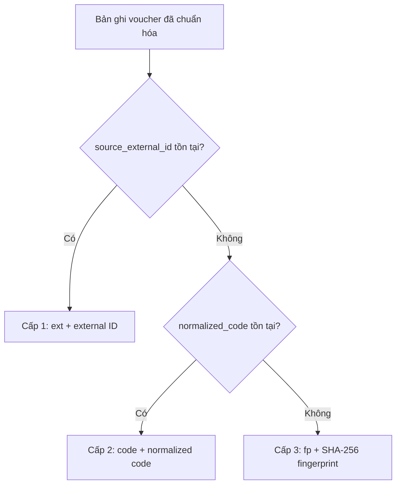
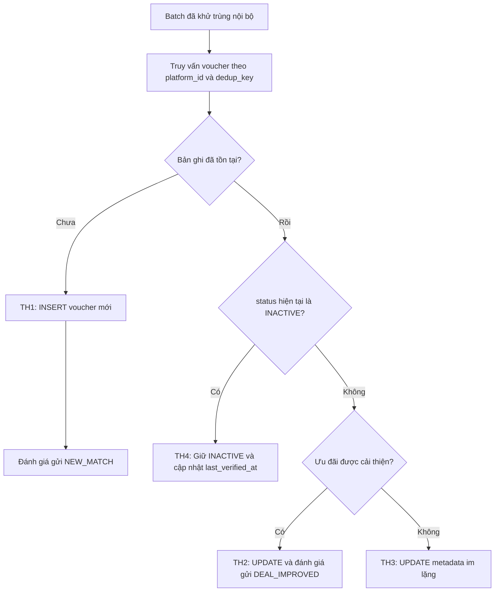

# Deduplication 3-Level Algorithm & Upsert Specification

| Thuộc tính | Giá trị |
|---|---|
| Dự án | DealHunter — Smart E-commerce Voucher Aggregator |
| Phiên bản | 1.0 |
| Phạm vi | `collectors/`, `services/voucher_service.py`, `services/notification_service.py` |

## Mục lục

- [1. Mục tiêu và bối cảnh](#1-mục-tiêu-và-bối-cảnh)
- [2. Tiền xử lý và chuẩn hóa](#2-tiền-xử-lý-và-chuẩn-hóa)
- [3. Thuật toán chống trùng 3 cấp độ](#3-thuật-toán-chống-trùng-3-cấp-độ)
  - [3.1. Cấp 1 — External ID](#31-cấp-1--external-id-ext)
  - [3.2. Cấp 2 — Mã voucher](#32-cấp-2--mã-voucher-code)
  - [3.3. Cấp 3 — Dấu vân tay](#33-cấp-3--dấu-vân-tay-fingerprint-fp)
- [4. Chống trùng trong lô](#4-chống-trùng-trong-lô-intra-batch-deduplication)
- [5. Chiến lược cập nhật dữ liệu](#5-chiến-lược-cập-nhật-dữ-liệu-upsert)
- [6. Câu lệnh PostgreSQL UPSERT](#6-câu-lệnh-postgresql-upsert)
- [7. Chống spam thông báo](#7-cơ-chế-chống-spam-thông-báo-sau-upsert)
- [8. Ma trận kiểm thử](#8-ma-trận-kịch-bản-kiểm-thử-test-cases-reference)

---

## 1. Mục tiêu và bối cảnh

Trong quá trình thu thập mã giảm giá từ nhiều nguồn, hệ thống đối mặt với ba thách thức dữ liệu cốt lõi:

1. **Trùng lặp giữa các lần quét:** Cùng một voucher được quét định kỳ không được tạo thành nhiều bản ghi trong bảng `vouchers`.
2. **Định danh nguồn không nhất quán:** Một số nguồn cung cấp `source_external_id`, một số chỉ có `code`, trong khi deal giảm giá tự động qua link không có cả hai trường.
3. **Cập nhật ưu đãi và chống spam:** Khi voucher hiện có được sàn nâng mức giảm hoặc hạ mức đơn tối thiểu, hệ thống cập nhật bản ghi cũ thay vì tạo bản ghi mới và chỉ kích hoạt `DEAL_IMPROVED` đúng một lần cho người dùng phù hợp.

Nguồn dữ liệu có thể đến từ:

- API mở;
- Tệp JSON/CSV quét định kỳ mỗi 2 giờ qua Celery Beat;
- Admin nạp thủ công.

Để giải quyết các thách thức trên, DealHunter kết hợp:

- Thuật toán sinh khóa chống trùng 3 cấp độ (`dedup_key`);
- Ràng buộc duy nhất `UNIQUE (platform_id, dedup_key)`;
- Cơ chế PostgreSQL atomic UPSERT.

---

## 2. Tiền xử lý và chuẩn hóa

Trước khi tính `dedup_key`, mọi bản ghi đầu vào đều qua `normalize_voucher_payload(raw_item)` để loại bỏ sai lệch hình thức, bao gồm khoảng trắng thừa, chữ hoa/thường, định dạng số thập phân và khác biệt biểu diễn Unicode.

| Trường / dữ liệu | Quy tắc chuẩn hóa |
|---|---|
| Unicode | Áp dụng `unicodedata.normalize('NFC', value)` cho toàn bộ chuỗi. |
| `source_external_id` | `TRIM(source_external_id)`; chuỗi rỗng `""` được gán `None` (`NULL`). |
| `code` | `code = TRIM(code)`; chuỗi rỗng được gán `None`. |
| `normalized_code` | `UPPERCASE(REGEXP_REPLACE(TRIM(code), '\s+', ''))`. Ví dụ: `" sale 50k "` → `"SALE50K"`. |
| `discount_value`, `min_order_value` | Chuyển sang `Decimal` với đúng 2 chữ số thập phân. Ví dụ: `50000` → `"50000.00"`. |

---

## 3. Thuật toán chống trùng 3 cấp độ

`dedup_key` có kiểu `VARCHAR(128)` và luôn bắt đầu bằng tiền tố của cấp độ tương ứng: `ext:`, `code:` hoặc `fp:`. Tiền tố ngăn va chạm giữa các cấp độ khác nhau.



### 3.1. Cấp 1 — External ID (`ext:`)

**Điều kiện áp dụng**

`source_external_id` tồn tại và khác rỗng sau khi `TRIM`.

**Công thức**

$$
\text{dedup\_key} = \text{"ext:"} + \text{TRIM}(\text{source\_external\_id})
$$

**Ví dụ**

`source_external_id = " AT_9981273 "` → `dedup_key = "ext:AT_9981273"`.

**Lý do ưu tiên**

ID từ hệ thống gốc là định danh bất biến do nhà cung cấp quản lý. Khi sàn sửa tiêu đề hoặc nâng mức giảm giá, `source_external_id` vẫn giữ nguyên và hệ thống nhận diện chính xác voucher cũ.

### 3.2. Cấp 2 — Mã voucher (`code:`)

**Điều kiện áp dụng**

`source_external_id` bị thiếu hoặc `NULL` **VÀ** `code` tồn tại, khác rỗng sau khi chuẩn hóa.

**Công thức**

$$
\text{normalized\_code}
= \text{UPPERCASE}(
\text{REGEXP\_REPLACE}(\text{TRIM}(\text{code}), \text{'\s+'}, \text{''})
)
$$

$$
\text{dedup\_key} = \text{"code:"} + \text{normalized\_code}
$$

**Ví dụ**

- `code = "  shopee 50k "`
- `normalized_code = "SHOPEE50K"`
- `dedup_key = "code:SHOPEE50K"`

**Phạm vi duy nhất**

Ràng buộc cơ sở dữ liệu là `UNIQUE (platform_id, dedup_key)`. Hai sàn khác nhau, chẳng hạn Shopee và Lazada, cùng phát hành mã `WELCOME50` sẽ không ghi đè lẫn nhau vì `platform_id` khác nhau.

### 3.3. Cấp 3 — Dấu vân tay fingerprint (`fp:`)

**Điều kiện áp dụng**

Thiếu cả `source_external_id` lẫn `code`. Trường hợp này thường gặp ở chương trình giảm giá tự động qua link hoặc auto-apply voucher.

#### Công thức

1. Chuẩn hóa tiêu đề:

   $$
   \text{norm\_title}
   = \text{LOWERCASE}(
   \text{REGEXP\_REPLACE}(\text{TRIM}(\text{title}), \text{'\s+'}, \text{''})
   )
   $$

2. Chuẩn hóa đường dẫn nguồn:

   $$
   \text{norm\_url}
   = \text{LOWERCASE}(\text{TRIM}(\text{source\_url} \text{ nếu có, ngược lại } \text{""}))
   $$

3. Ghép chuỗi thô bằng ký tự phân tách `|` để tránh va chạm ranh giới trường:

   $$
   \begin{aligned}
   \text{raw\_str} =
   &\text{STR}(\text{platform\_id}) \mathbin{\Vert} \text{"|"} \mathbin{\Vert}
   \text{norm\_title} \mathbin{\Vert} \text{"|"} \mathbin{\Vert}
   \text{discount\_type} \mathbin{\Vert} \text{"|"} \mathbin{\Vert}
   \text{FORMAT\_2DP}(\text{discount\_value}) \mathbin{\Vert} \text{"|"} \mathbin{\Vert} \\
   &\text{FORMAT\_2DP}(\text{min\_order\_value})
   \mathbin{\Vert} \text{"|"} \mathbin{\Vert}
   \text{norm\_url}
   \end{aligned}
   $$

4. Băm SHA-256 và chuyển kết quả thành chuỗi hex 64 ký tự chữ thường:

   $$
   \text{dedup\_key} = \text{"fp:"} + \text{SHA256}(\text{raw\_str})
   $$

**Ví dụ**

- `raw_str`: `"550e8400-e29b-41d4-a716-446655440001|giảm30kđơnthờitrang|FIXED_AMOUNT|30000.00|150000.00|https://shopee.vn/deal-1"`
- `dedup_key`: `"fp:8f4e2b9c1a0d7e6f..."`.
- Tổng độ dài: `3 + 64 = 67` ký tự, nằm trong giới hạn `VARCHAR(128)`.

**Ý nghĩa thiết kế**

Đưa `discount_value` và `min_order_value` vào hàm băm giúp phân tách các voucher phát hành trong cùng chiến dịch. Ví dụ, giảm 20K cho đơn 100K và giảm 50K cho đơn 300K vẫn là hai bản ghi độc lập dù có cùng trang chiến dịch và `source_url`.

---

## 4. Chống trùng trong lô (Intra-Batch Deduplication)

PostgreSQL phát sinh lỗi `CardinalityViolation: ON CONFLICT DO UPDATE command cannot affect row a second time` nếu một câu lệnh `INSERT ... ON CONFLICT DO UPDATE` chứa hai dòng trùng cặp `(platform_id, dedup_key)` trong cùng batch.

Trước khi ghi DB, Collector bắt buộc thực hiện:

1. Duyệt tuần tự danh sách voucher đã chuẩn hóa.
2. Lưu vào `batch_map[(platform_id, dedup_key)]`.
3. Khi gặp bản ghi trùng:
   - Giữ bản ghi có ưu đãi tốt hơn:
     - `discount_value` lớn hơn; hoặc
     - `discount_value` bằng nhau nhưng `min_order_value` nhỏ hơn.
   - Nếu các chỉ số ưu đãi bằng nhau, giữ bản ghi xuất hiện sau cùng.

---

## 5. Chiến lược cập nhật dữ liệu (UPSERT)

### 5.1. Luồng xử lý tổng quát



### 5.2. Chi tiết các trường hợp

#### Trường hợp 1 — Bản ghi hoàn toàn mới (`INSERT`)

**Điều kiện**

Cặp `(platform_id, dedup_key)` chưa tồn tại trong `vouchers`.

**Hành động DB**

- Chèn bản ghi mới.
- Tính `status`:
  - `ACTIVE` nếu `expiry_date IS NULL` hoặc `expiry_date > NOW()`;
  - `EXPIRED` nếu `expiry_date <= NOW()`.
- Thiết lập `last_verified_at = NOW()`, `created_at = NOW()` và `updated_at = NOW()`.

**Thông báo**

Nếu voucher mới đang `ACTIVE`, đẩy sang service đối chiếu `user_preferences` đang bật (`is_active = TRUE`) để sinh thông báo `NEW_MATCH`.

#### Trường hợp 2 — Ưu đãi được nâng cấp (`UPDATE` + `DEAL_IMPROVED`)

**Điều kiện**

Bản ghi đã tồn tại với `status != 'INACTIVE'`, voucher mới còn hiệu lực (`expiry_date IS NULL OR expiry_date > NOW()`) và thỏa mãn ít nhất một điều kiện:

1. Tăng mức giảm với cùng loại giảm:

   $$
   \text{discount\_value}_{\text{mới}}
   >
   \text{discount\_value}_{\text{cũ}}
   $$

2. Giảm ngưỡng đơn hàng tối thiểu:

   $$
   \text{min\_order\_value}_{\text{mới}}
   <
   \text{min\_order\_value}_{\text{cũ}}
   $$

**Hành động DB**

- Lưu giá trị cũ `old_discount_value` và `old_min_order_value` trước khi ghi đè.
- Cập nhật `title`, `description`, `code`, `normalized_code`, `discount_type`, `discount_value`, `min_order_value`, `max_discount`, `start_date`, `expiry_date`, `source_url` và đặt `status = 'ACTIVE'`.
- Cập nhật `last_verified_at = NOW()` và `updated_at = NOW()`.

**Thông báo**

Sinh thông báo `DEAL_IMPROVED` cho người dùng có tiêu chí khớp với thông số mới.

Nội dung phải thể hiện rõ thay đổi trước/sau. Ví dụ:

> “Mã giảm giá Shopee `SALE50K` vừa nâng mức giảm từ 30.000 VNĐ lên 50.000 VNĐ!”

#### Trường hợp 3 — Chỉ cập nhật metadata hoặc xác minh lại (`UPDATE` im lặng)

**Điều kiện**

Bản ghi đã tồn tại với `status != 'INACTIVE'` và mức ưu đãi không tốt hơn bản ghi cũ:

$$
\text{discount\_value}_{\text{mới}} \le
\text{discount\_value}_{\text{cũ}}
\quad \text{và} \quad
\text{min\_order\_value}_{\text{mới}} \ge
\text{min\_order\_value}_{\text{cũ}}
$$

Hoặc dữ liệu quét lại hoàn toàn giống bản ghi cũ.

**Hành động DB**

- Cập nhật mô tả/thời hạn nếu thay đổi: `title`, `description`, `expiry_date`, `source_url`, `max_discount`.
- Nếu `expiry_date <= NOW()`, đặt `status = 'EXPIRED'`; ngược lại giữ `ACTIVE`.
- Cập nhật `last_verified_at = NOW()` và `updated_at = NOW()` nếu dữ liệu thay đổi.

**Thông báo**

Không sinh thông báo để tránh làm phiền người dùng khi worker chạy định kỳ mỗi 2 giờ.

#### Trường hợp 4 — Bản ghi bị vô hiệu hóa mềm (`status = INACTIVE`)

**Điều kiện**

Bản ghi đã tồn tại trong DB với `status = 'INACTIVE'` do Admin thực hiện:

- `DELETE /api/v1/vouchers/{id}`; hoặc
- Khóa thủ công voucher lỗi/vi phạm.

**Hành động DB**

- Không tự động chuyển về `ACTIVE`.
- Chỉ cập nhật `last_verified_at = NOW()` để ghi nhận nguồn vẫn phát hành voucher.
- Bảo toàn quyết định kiểm duyệt của Admin.

**Thông báo**

Không sinh thông báo.

---

## 6. Câu lệnh PostgreSQL UPSERT

```sql
INSERT INTO vouchers (
    id,
    platform_id,
    dedup_key,
    source_external_id,
    code,
    normalized_code,
    title,
    description,
    discount_type,
    discount_value,
    min_order_value,
    max_discount,
    start_date,
    expiry_date,
    source_url,
    status,
    last_verified_at,
    created_at,
    updated_at
)
VALUES (
    :id,
    :platform_id,
    :dedup_key,
    :source_external_id,
    :code,
    :normalized_code,
    :title,
    :description,
    :discount_type,
    :discount_value,
    :min_order_value,
    :max_discount,
    :start_date,
    :expiry_date,
    :source_url,
    :status,
    CURRENT_TIMESTAMP,
    CURRENT_TIMESTAMP,
    CURRENT_TIMESTAMP
)
ON CONFLICT (platform_id, dedup_key)
DO UPDATE SET
    source_external_id = COALESCE(EXCLUDED.source_external_id, vouchers.source_external_id),
    code               = COALESCE(EXCLUDED.code, vouchers.code),
    normalized_code    = COALESCE(EXCLUDED.normalized_code, vouchers.normalized_code),
    title              = EXCLUDED.title,
    description        = COALESCE(EXCLUDED.description, vouchers.description),
    discount_type      = EXCLUDED.discount_type,
    discount_value     = EXCLUDED.discount_value,
    min_order_value    = EXCLUDED.min_order_value,
    max_discount       = EXCLUDED.max_discount,
    start_date         = COALESCE(EXCLUDED.start_date, vouchers.start_date),
    expiry_date        = COALESCE(EXCLUDED.expiry_date, vouchers.expiry_date),
    source_url         = COALESCE(EXCLUDED.source_url, vouchers.source_url),
    status             = CASE
                           WHEN vouchers.status = 'INACTIVE' THEN 'INACTIVE'
                           WHEN EXCLUDED.expiry_date IS NOT NULL
                                AND EXCLUDED.expiry_date <= CURRENT_TIMESTAMP
                           THEN 'EXPIRED'
                           ELSE 'ACTIVE'
                         END,
    last_verified_at   = CURRENT_TIMESTAMP,
    updated_at         = CURRENT_TIMESTAMP
WHERE vouchers.status <> 'INACTIVE'
RETURNING id, (xmax = 0) AS is_inserted;
```

Trong PostgreSQL, `(xmax = 0)` trong `RETURNING` cho biết bản ghi vừa được `INSERT` (`true`) hay `UPDATE` từ bản ghi cũ (`false`). Kết hợp với ảnh chụp giá trị cũ trước giao dịch, tầng Service xác định chính xác danh sách voucher kích hoạt `NEW_MATCH` và `DEAL_IMPROVED`.

---

## 7. Cơ chế chống spam thông báo sau UPSERT

Khi sinh thông báo, `NotificationService` thực thi lệnh chèn idempotent dựa trên ràng buộc:

```text
UNIQUE (user_id, voucher_id, notification_type)
```

```sql
INSERT INTO notifications (
    id,
    user_id,
    voucher_id,
    notification_type,
    title,
    message,
    is_read,
    created_at
)
VALUES (
    gen_random_uuid(),
    :user_id,
    :voucher_id,
    :notification_type,
    :title,
    :message,
    FALSE,
    CURRENT_TIMESTAMP
)
ON CONFLICT (user_id, voucher_id, notification_type) DO NOTHING;
```

### Gộp nhiều tiêu chí khớp

Nếu người dùng có hai tiêu chí:

- Tiêu chí 1: mọi mã Shopee giảm $\ge 20\text{K}$;
- Tiêu chí 2: mọi mã giảm $\ge 30\text{K}$;

và có một voucher Shopee giảm $50\text{K}$ được nạp, `ON CONFLICT DO NOTHING` bảo đảm người dùng chỉ nhận duy nhất một thông báo thay vì hai thông báo trùng nội dung.

### Chạy lại tác vụ an toàn

Nếu Celery Worker retry một tác vụ bị gián đoạn giữa chừng:

- Không tạo thêm bản ghi voucher trùng;
- Không tạo thêm bản ghi thông báo trùng.

---

## 8. Ma trận kịch bản kiểm thử (Test Cases Reference)

| Mã | Tình huống đầu vào | Hành vi mong đợi |
|---|---|---|
| `TC-DEDUP-01` | Có đủ `source_external_id = "AT01"` và `code = "SALE10"` | Sinh `dedup_key = "ext:AT01"`; ưu tiên cấp 1 và bỏ qua cấp 2. |
| `TC-DEDUP-02` | Không có `source_external_id`; `code = "  tet 2026 "` | Sinh `normalized_code = "TET2026"` và `dedup_key = "code:TET2026"`; cấp 2. |
| `TC-DEDUP-03` | Thiếu cả `source_external_id` và `code` | Sinh `dedup_key = "fp:<64-hex-sha256>"`; cấp 3. |
| `TC-DEDUP-04` | Thiếu ID/code, tiêu đề/link giống nhau, `discount_value` khác (`20K` vs `50K`) | Sinh hai `dedup_key` fingerprint khác nhau; lưu hai bản ghi riêng biệt. |
| `TC-DEDUP-05` | Cùng `code = "WELCOME50"` trên hai sàn `Shopee` và `Lazada` | Lưu hai bản ghi độc lập nhờ `UNIQUE (platform_id, dedup_key)`. |
| `TC-UPSERT-01` | Nạp lại tệp JSON giống lần đầu | Số dòng trong `vouchers` không đổi; `last_verified_at` cập nhật; không sinh thông báo mới. |
| `TC-UPSERT-02` | Voucher hiện có có `discount_value` tăng từ `30000` lên `50000` | Cập nhật giá trị thành `50000.00` trên bản ghi cũ và kích hoạt `DEAL_IMPROVED`. |
| `TC-UPSERT-03` | Voucher hiện có có `min_order_value` giảm từ `300000` xuống `150000` | Cập nhật giá trị thành `150000.00` trên bản ghi cũ và kích hoạt `DEAL_IMPROVED`. |
| `TC-UPSERT-04` | Voucher có `status = 'INACTIVE'` do Admin | Giữ `INACTIVE`; không kích hoạt lại; không gửi thông báo. |
| `TC-UPSERT-05` | JSON chứa hai phần tử trùng `(platform_id, dedup_key)` trong cùng batch | Tiền xử lý gộp batch trước khi ghi DB; không phát sinh lỗi `CardinalityViolation`. |
